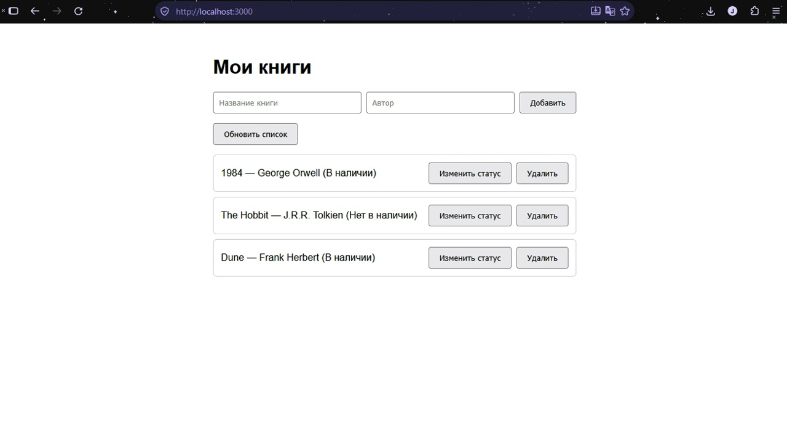
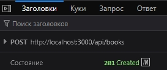
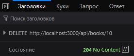

# Занятие 7. Браузерный интерфейс для собственного API

## Установка и запуск
1. Установите зависимости: `npm install`
2. Запустите сервер: `npm start`
3. Откройте в браузере: `http://localhost:3000`

## Структура проекта
* `server.js` — Express-сервер, маршруты API и раздача статики.
* `public/` — папка с фронтендом.
  * `index.html` — разметка интерфейса.
  * `style.css` — стили.
  * `app.js` — логика клиента (fetch, render).
* `data.db` — файл базы данных SQLite (создается автоматически).

## Схема обмена
Браузер (fetch) → Express-маршрут → SQL-запрос → SQLite → JSON-ответ → render() → DOM.

## Используемые API-маршруты
* `GET /api/books` — получить список.
* `POST /api/books` — добавить книгу.
* `PATCH /api/books/:id` — изменить статус.
* `DELETE /api/books/:id` — удалить книгу.

## Действия пользователя в интерфейсе
На странице можно: посмотреть список книг, добавить новую книгу, изменить её статус (доступна/недоступна) и удалить с подтверждением.

## Скриншоты
- Страница в браузере

- Запросы
POST:

DELETE:

## Проверка ошибок
* **400 (Bad Request):** При попытке отправить пустую форму выводится сообщение «Заполните название и автора».
* **Сервер недоступен:** Если остановить сервер и нажать «Обновить», выводится сообщение «Не удалось загрузить данные: Failed to fetch».
* **404 (Not Found):** Проверено с помощью двух вкладок браузера. Если удалить книгу в одной вкладке, а во второй (где список ещё не обновлён) попытаться удалить её же, сервер возвращает 404, а интерфейс выводит сообщение об ошибке: «Book not found». Также 404 можно увидеть, если вручную отправить запрос на удаление несуществующего ID (например, через консоль браузера).

## Сохранение данных после перезапуска
После добавления книги и перезапуска сервера (Ctrl+C → npm start) данные сохраняются в файле SQLite и успешно отображаются на странице при повторном открытии.

## Почему использован textContent, а не innerHTML
Использование `textContent` предотвращает XSS-атаки. Если ввести в название книги `<b>Проверка</b>`, на странице отобразится текст с угловыми скобками, а не жирный шрифт. `innerHTML` вставил бы это как HTML-код, что небезопасно.