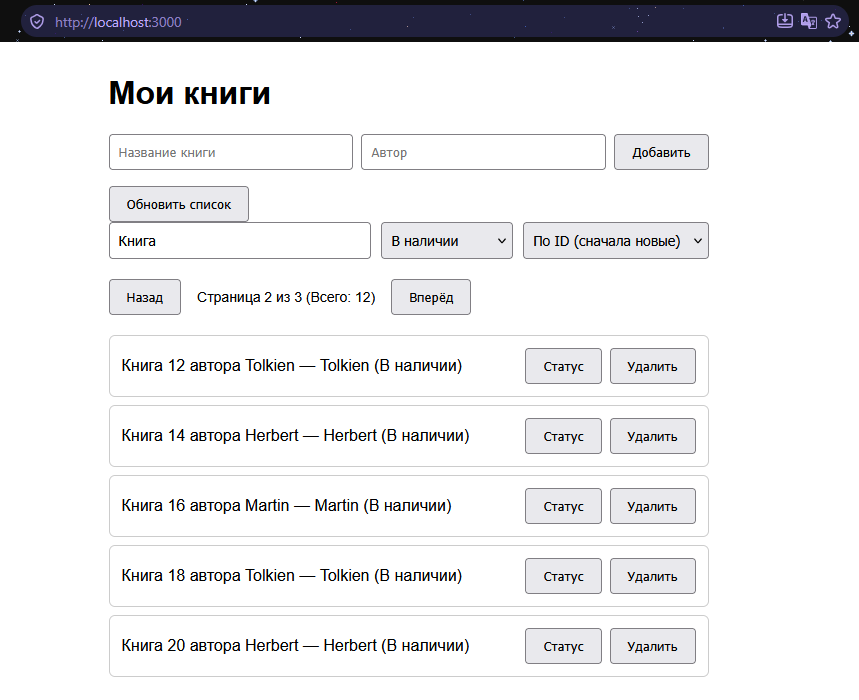
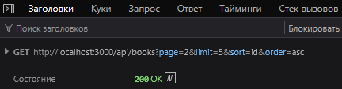

# Занятие 8. Каталог с серверным поиском и пагинацией

## Запуск и структура проекта
**Запуск:**
1. Установите зависимости: `npm install`
2. Заполните базу тестовыми данными (25 записей): `node seed.js`
3. Запустите сервер: `npm start`
4. Откройте в браузере: `http://localhost:3000`

**Структура:**
```text
08/
├── public/           # Фронтенд (HTML, CSS, JS)
│   ├── index.html
│   ├── style.css
│   └── app.js
├── server.js         # Express-сервер, API-маршруты и SQL-запросы
├── seed.js           # Скрипт для генерации 25 тестовых записей
├── package.json      # Зависимости и скрипты
├── data.db           # Файл базы данных SQLite (создается автоматически)
└── .gitignore        # Игнорирование node_modules и data.db
```

## Параметры API (GET /api/books)
| Параметр | Допустимые значения | По умолчанию | Описание |
| :--- | :--- | :--- | :--- |
| `page` | Целое число > 0 | 1 | Номер страницы |
| `limit` | Целое число от 1 до 50 | 5 | Записей на странице |
| `search` | Любая строка | - | Поиск по названию |
| `available` | `true` или `false` | - | Фильтр по наличию |
| `sort` | `id`, `title`, `author` | `id` | Поле сортировки |
| `order` | `asc`, `desc` | `asc` | Направление сортировки |

## Пример JSON-ответа с пагинацией
```json
{
  "items": [
    { "id": 2, "title": "Книга 2", "author": "Orwell", "available": true }
  ],
  "pagination": {
    "page": 1,
    "limit": 5,
    "total": 25,
    "pages": 5
  }
}
```
## SQL-запросы
В коде сервера динамически собираются следующие SQL-запросы (с использованием параметризации):
- WHERE (фильтрация и поиск):
```sql
SELECT * FROM books WHERE title LIKE ? AND available = ?
```
*(Параметры передаются отдельно:* `['%текст%', 1]`*)*
- ORDER BY (сортировка):
```sql
ORDER BY title ASC, id ASC
```
*(Имена столбцов и направление подставляются только из белого списка)*
- LIMIT / OFFSET (пагинация):
```sql
LIMIT ? OFFSET ?
```
*(Вычисляется:* `offset = (page - 1) * limit`*)*

## Защита от SQL-инъекций
В SQLite (и большинстве СУБД) нельзя передать имя столбца для `ORDER BY через` плейсхолдер `?`. Поэтому, если напрямую вставить `req.query.sort` в строку запроса, злоумышленник может провести SQL-инъекцию.

**Как защищено:**
В `server.js` создан белый список допустимых колонок:
```javascript
const sortColumns = { id: 'id', title: 'title', author: 'author', available: 'available' };
```
Сначала код проверяет, есть ли запрошенное поле в этом списке. Если поле не найдено (или направление не `asc`/`desc`), сервер возвращает ошибку `400 Bad Request`. В сам SQL-запрос попадает только безопасное значение из белого списка (`sortColumns[sort]`), а не ввод пользователя.

Для фильтрации (`WHERE`) используются параметризованные запросы со знаком `?`.

## Снимки интерфейса и Network
### Интерфейс

### Network: Пагинация

### Network: Совместный поиск и фильтр

### Network: Ошибка 400 Bad Request


## Результаты проверок
Все обязательные проверки выполнены успешно:
- Разные записи на страницах: На первой и второй странице отображаются разные книги (по 5 штук).
- Равенство total: При включении фильтра "В наличии" (total = 12), сервер возвращает именно 12 в метаданных, а не 5 (размер страницы).
- Совместный поиск: Поиск по слову "Книга" с фильтром "В наличии" корректно возвращает только подходящие записи.
- Сортировка: Сортировка по title (asc) и author (desc) работает корректно.
- Пустой результат: При поиске несуществующей книги (например, "абракадабра") выводится сообщение "Ничего не найдено", а total равен 0.
- Ошибка 400: При запросе http://localhost:3000/api/books?page=0, ?sort=nonexistent или ?available=maybe сервер возвращает {"error":"Некорректные параметры запроса"} со статусом 400 Bad Request.
- Удаление на последней странице: При удалении единственной записи на последней странице интерфейс автоматически переключается на предыдущую страницу, не оставляя пользователя на пустом экране.
- Сохранение после перезапуска: После перезапуска Node.js (Ctrl+C -> npm start) данные сохраняются, так как они хранятся в SQLite.

## Чем серверная фильтрация отличается от array.filter() в браузере
- **Клиентская фильтрация (`array.filter` в браузере)**: Требует, чтобы сервер сначала передал все записи (например, 10 000 штук). Браузер загружает их в память, после чего скрипт перебирает массив. Это расходует много трафика и оперативной памяти. Если база вырастет до 1 000 000 записей, браузер зависнет.
- **Серверная фильтрация**: Браузер отправляет параметры (например, `?search=книга&page=2`) на сервер. Сервер (`SQLite`) сам выполняет фильтрацию, сортировку и обрезку (`LIMIT/OFFSET`) и возвращает браузеру только те 5-10 записей, которые нужны для отображения текущей страницы. Это экономит трафик, память клиента и работает мгновенно при любом размере базы данных.